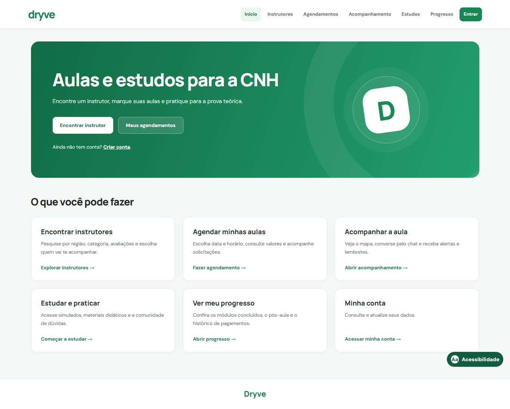

# Dryve — Aulas práticas e estudos para a CNH

O Dryve é um projeto acadêmico do Grupo 6. A ideia foi reunir no mesmo site o que um aluno usa para se preparar para a CNH e combinar aulas práticas com um instrutor. O sistema foi feito com PHP, MySQL ou MariaDB, HTML, CSS e JavaScript.

## O que o sistema faz

- **Aluno** busca instrutores por categoria e região, solicita aulas, usa cupons, faz simulados e acompanha o próprio progresso.
- **Instrutor** cadastra horários e pontos de encontro, responde aos agendamentos e registra observações depois da aula.
- **Administrador** consulta as contas e organiza as transmissões e gravações da área de estudos.

Na aula confirmada, aluno e instrutor podem conversar pelo chat e consultar a rota. Depois, o aluno pode deixar uma avaliação para o instrutor. O sistema também tem alto contraste, ampliação de texto até 200% e destaque de links.

## Como rodar no Windows

1. Instale o [XAMPP](https://www.apachefriends.org/download.html) com PHP 8.1 ou mais recente.
2. Baixe o ZIP pelo botão acima e extraia o arquivo. Copie a pasta `Dryve_Integrado` para `C:\xampp\htdocs`.
3. No painel do XAMPP, inicie **Apache** e **MySQL**. No [phpMyAdmin](http://localhost/phpmyadmin), use **Importar** para abrir o `database.sql` da raiz. O script cria o banco `dryve` e inclui dados fictícios.
4. Abra [http://localhost/Dryve_Integrado/](http://localhost/Dryve_Integrado/) no navegador.

### Contas de demonstração

| Perfil | Usuário |
| --- | --- |
| Aluna | `aluno_demo` |
| Instrutora | `instrutor_demo` |
| Administrador | `admin_demo` |

Use a senha `Dryve2026` nas três contas. Para testar o agendamento, entre como aluna e instrutora em dois perfis do navegador. A aluna solicita a aula e a instrutora aceita. O cupom `DRYVE10` aplica 10% de desconto. O pagamento da demonstração é simulado.

## Para a avaliação individual

- **Qual banco foi usado?** O `dryve` é um banco relacional. O projeto funciona com MySQL e com o MariaDB do XAMPP. O PHP se conecta ao banco com `mysqli` e o [database.sql](database.sql) contém a estrutura e os dados de demonstração.
- **Quais tabelas você lembra?** `usuarios` guarda as contas, `instrutores` guarda os dados dos instrutores e `horarios` guarda os horários oferecidos. Cada registro em `agendamentos` liga um aluno a um horário. Quando o instrutor aceita a solicitação, o sistema registra a aula em `s4_aulas`. Outras tabelas são `avaliacoes`, com a nota e o comentário da aula, e `progresso`, com os módulos que cada aluno concluiu.
- **Foi usado POO?** O código do projeto é principalmente procedural, organizado em arquivos e funções. Por exemplo, a função `consulta()` em [app.php](Dryve_Integrado/app.php) prepara e executa as consultas ao banco. A conexão usa um objeto da extensão `mysqli`.
- **Quanto de IA foi usado?** Houve apoio de IA na implementação e revisão de partes do código, nos ajustes de acessibilidade, nos testes e na documentação. Para responder, vale dar um exemplo da sua parte e contar o que você conferiu no código ou no sistema.

## Telas e documentação

- [Telas do Dryve](docs/telas.md) com o fluxo de agendamento, o acompanhamento e o pós-aula.
- [Diagrama de casos de uso](Dryve_Integrado/docs/casos-de-uso.drawio) com os papéis de aluno, instrutor e administrador.
- [Validação do projeto](Dryve_Integrado/docs/validacao.md) com os cenários das seis sprints.
- [Configuração de mapa, e-mail e pagamento de teste](Dryve_Integrado/README.md#configuração-de-e-mail-mapa-e-pagamento).

O código fica em `Dryve_Integrado`, separado por sprint. O `database.sql` da raiz é a exportação usada para instalar o projeto.

## Grupo 6

- [Pietro Maruska](https://github.com/pietromaruska)
- [Pedro Henrique](https://github.com/Pedro-hrr-Borges)
- [Pedro Mautone](https://github.com/Pedrowtst)
- Rafael Velasques
- [João Vitor Bidese](https://github.com/Joaobidese)
