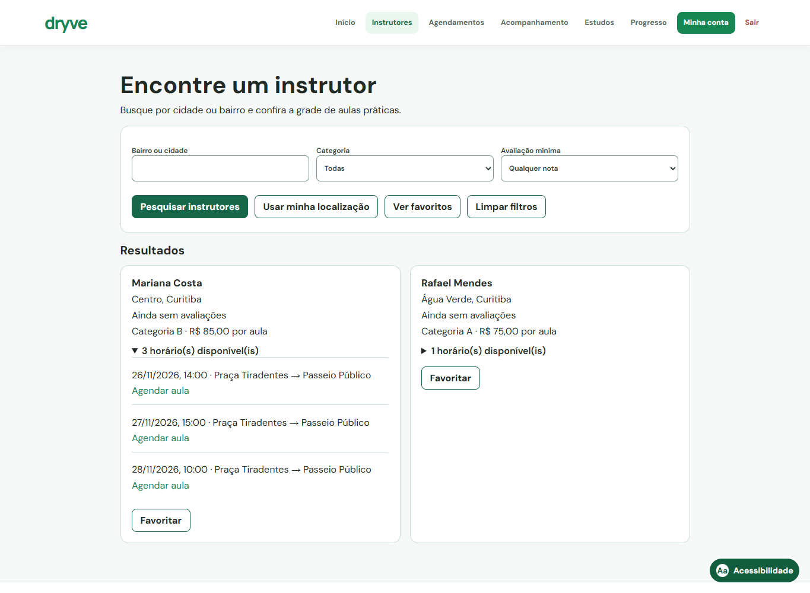
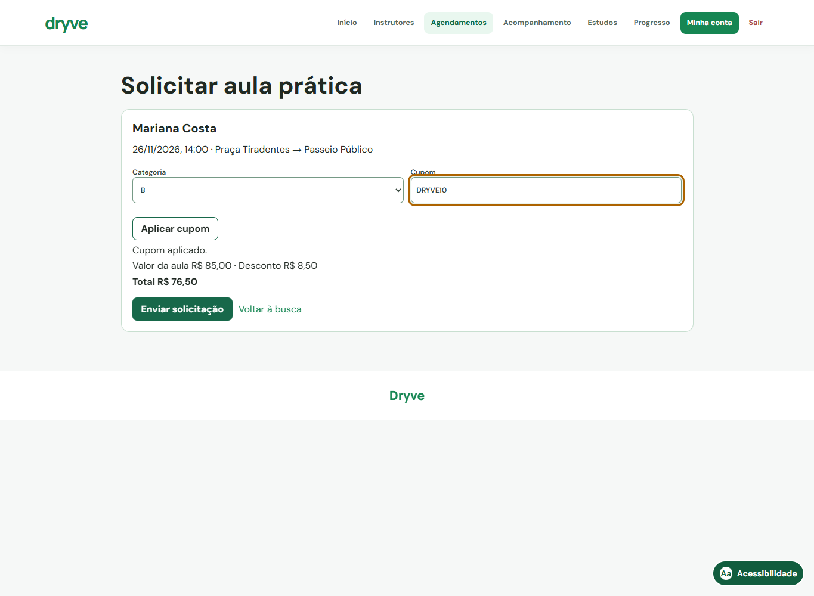
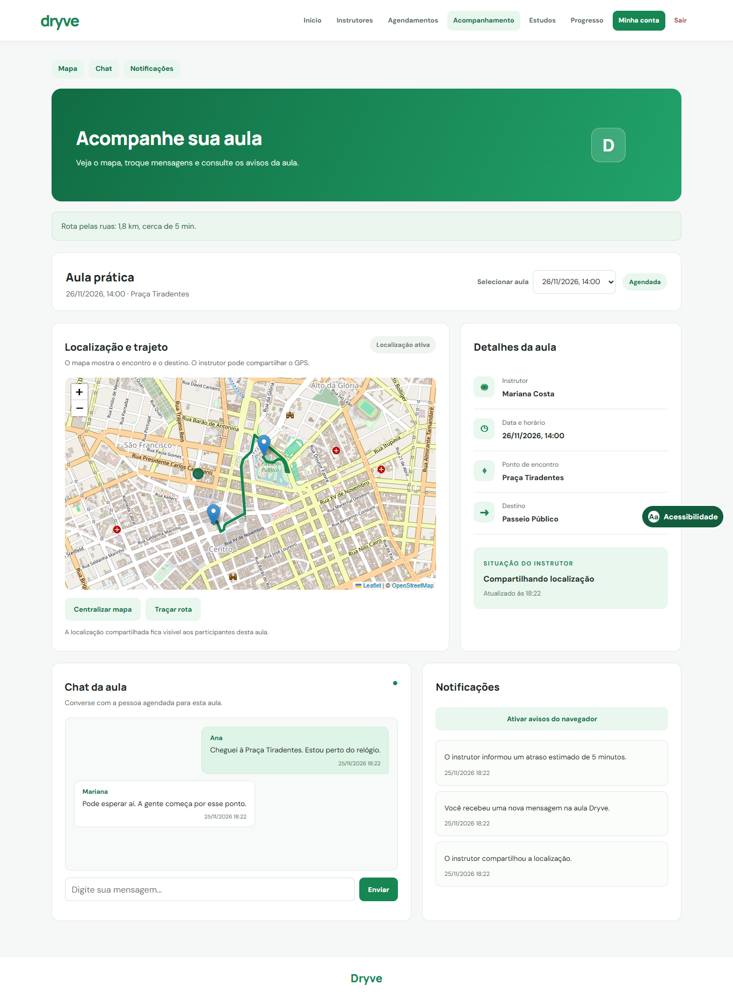
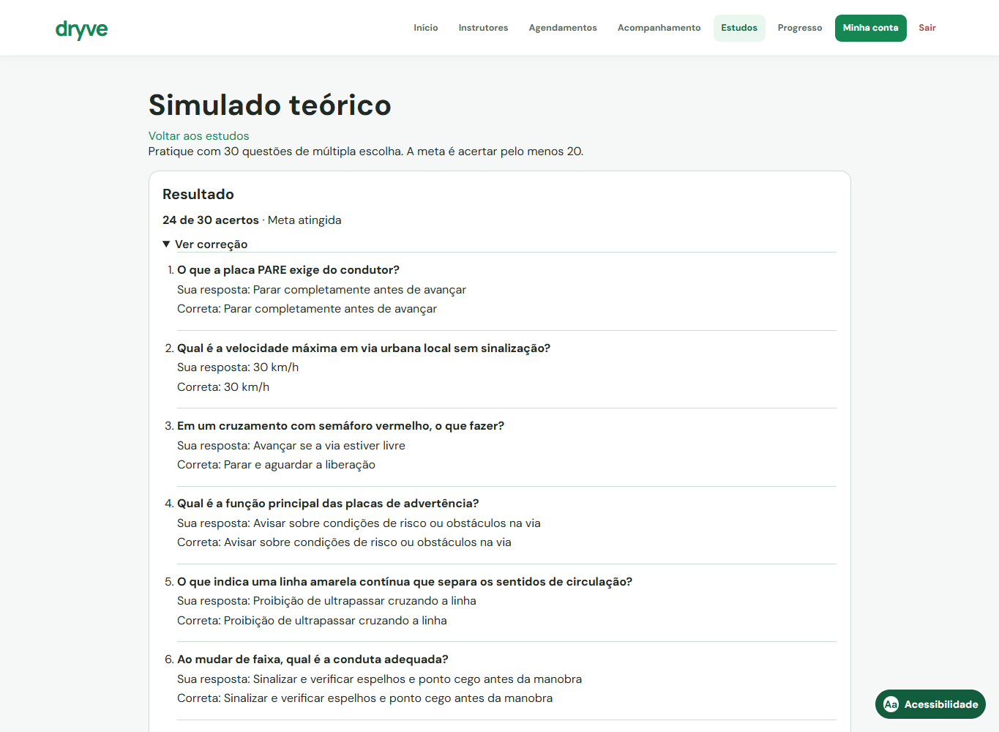
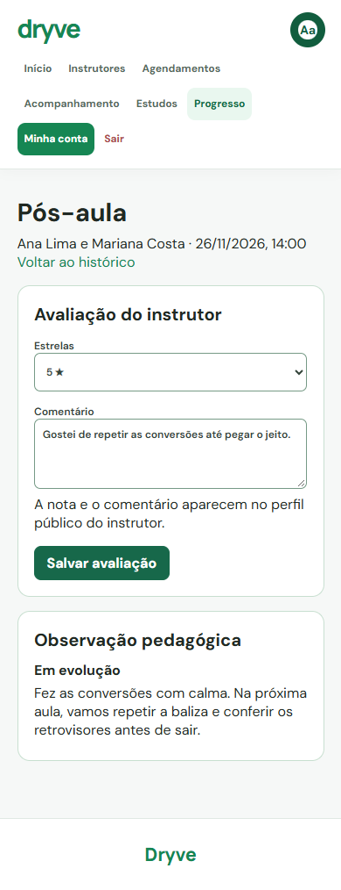
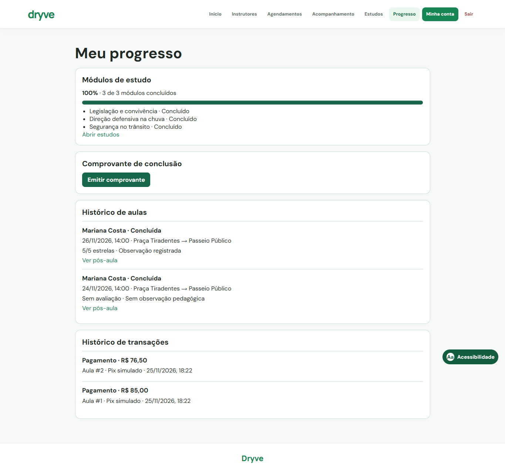
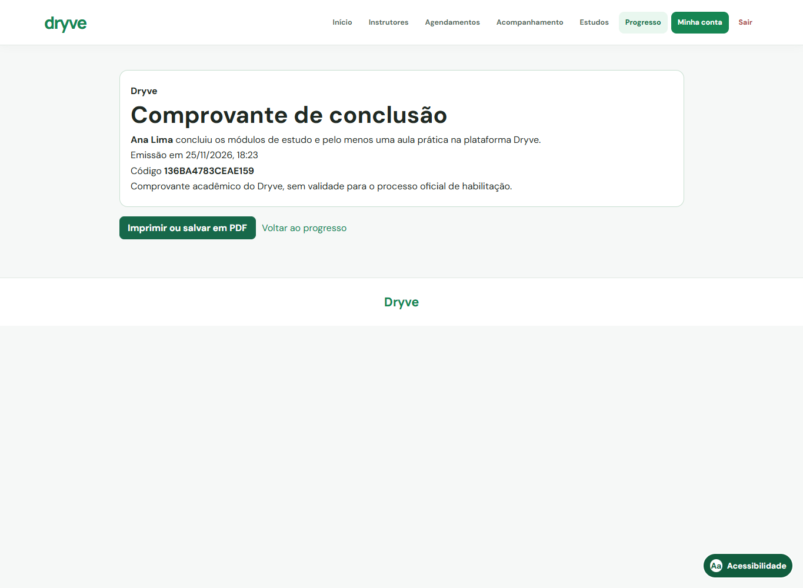
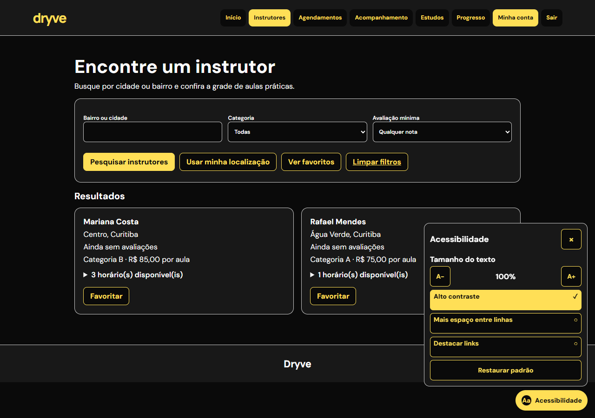

# Telas do Dryve

[Voltar ao README](../README.md)

As capturas foram feitas no projeto com as contas de demonstração. Os pagamentos e a localização exibidos são de teste.

## Busca de instrutores

A aluna abre a grade de uma instrutora para ver horários e locais disponíveis.

## Agendamento com cupom

O cupom `DRYVE10` reduz o valor de R$ 85,00 para R$ 76,50 no pedido.

## Acompanhamento da aula

A tela reúne a rota, o local da instrutora, o chat e o aviso de atraso.

## Simulado

No fim do simulado, a aluna vê o total de acertos e pode conferir cada resposta.

## Pós-aula no celular

A aluna avalia a aula e pode ler a observação registrada pela instrutora.

## Progresso

O painel mostra os módulos concluídos, o histórico de aulas e os pagamentos.

## Comprovante

O comprovante fica disponível quando o aluno termina os módulos de estudo e uma aula prática.

## Alto contraste

O alto contraste é aplicado aos menus, campos e cartões. O painel também permite ajustar o tamanho do texto.

